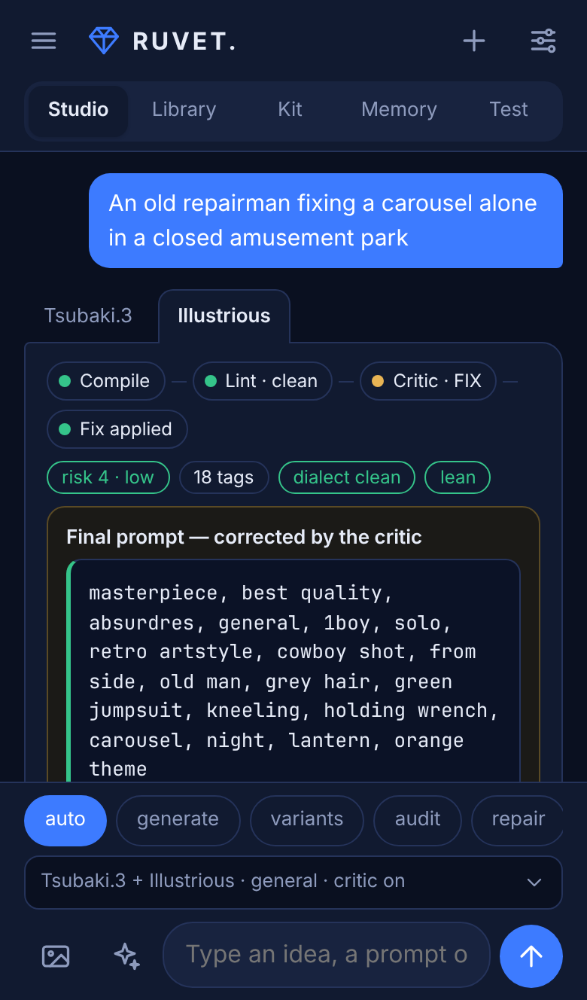
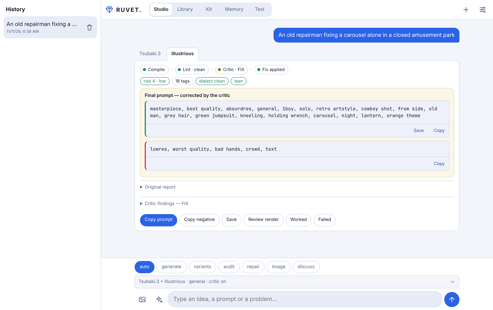
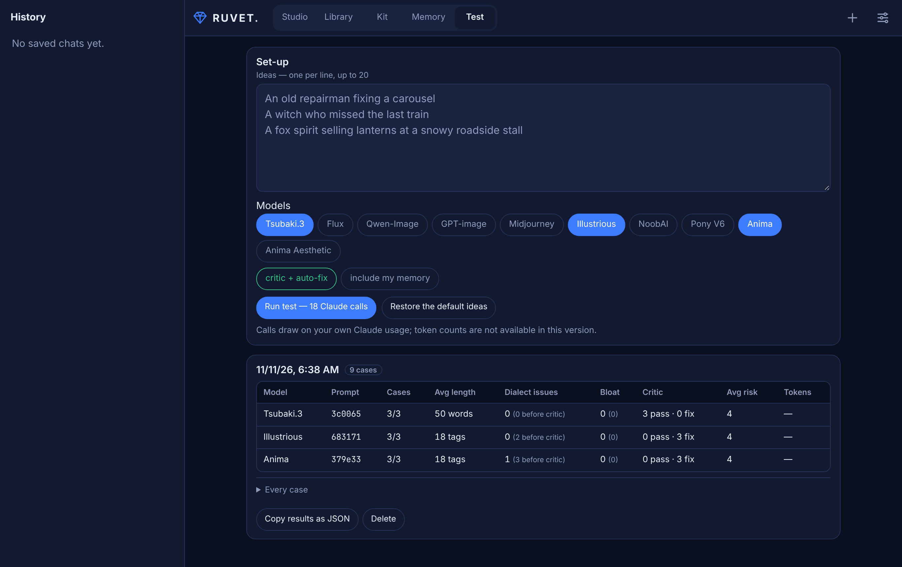

# RUVET.

**A prompt pipeline for anime and illustration image models.** Describe a picture, pick the image models you use, and RUVET. writes a prompt in each model's own dialect — then lints it, has a second pass audit and correct it, and learns from how your renders turned out. It runs the SAPPHIRE Vision Architect v15 prompt system on Claude. It does not generate images.

  
  &nbsp;
  

## Which version?

RUVET. comes in two versions built from the same code. They differ in how they reach Claude, not in what they do. **There is no separate mobile version:** both work on phones and on desktop.

| | **Claude artifact** — no key | **Web app** — your API key |
| --- | --- | --- |
| Runs on | a claude.ai page | your own site (GitHub Pages) or your computer |
| Pays for Claude | whoever opens it, from their own Claude plan | the Anthropic API key entered in Settings, per use |
| Set-up | none: open the link while signed in to claude.ai | publish `docs/`, then enter a key |
| Sharing | share the link; each person uses their own Claude | anyone who opens the site enters their own key |
| Choosing the model | a quality tier: balanced, most capable, fast | a specific Claude model and thinking effort |
| Images on a phone | in the phone's browser; not in the Claude Android app, which opens no file picker | yes |
| Token counts | not shown | shown on each result |
| Home-screen app | no, it stays a claude.ai page | yes, it installs as an app (PWA) |
| Source | `artifact/ruvet.html`, generated from `docs/` | `docs/` |

**Pick the artifact** if you have a Claude subscription, want nothing to set up, or want to share RUVET. with others at no cost to you. **Pick the web app** if you have an API key, want to choose the exact model, or want it installed like an app.

The Settings screen in either version says which one you are using.

### Open the artifact

1. Open https://claude.ai/artifact/8VYXKTLoew7FgWtfZMm7ci while signed in to claude.ai. It opens for people its owner has shared it with (*Share* menu on the page).
2. On the first request, allow the page to use Claude. Replies then draw on your own Claude usage.
3. On Android, attach images from the phone's browser rather than the Claude app.

To run your own copy, publish `artifact/ruvet.html` as a Claude artifact that declares the `sample` capability (with images) and `downloads`.

### Run the web app

1. Publish `docs/`: on GitHub, *Settings → Pages → Deploy from a branch → `main` / `/docs`*. Any static HTTPS host works.
2. Open the site and enter an Anthropic API key in Settings. The key stays in that browser and is sent only to `api.anthropic.com`.
3. To install it on a phone: Android/Chrome *Add to Home screen*, iOS/Safari *Share → Add to Home Screen*.

To try it locally: `npm install && npm run serve`, then open http://localhost:8080.

## The pipeline

Every request runs through these stages, shown as a stepper on each result:

1. **Compile** — SAPPHIRE stages the scene (one moment, framing, a state for every visible hand, support, one sourced light), scores how likely the render is to break, and writes the positive and negative prompts in the target model's syntax.
2. **Lint** — deterministic checks in the browser, no model call. *Dialect*: the target's own syntax — tag or word budget, weights, base and rating or safety tags per model, underscores and parentheses, Midjourney parameters, negatives on models without a negative field, LoRA base and trigger words. *Bloat*: repeated tags or words, more than one framing, angle, gaze or palette, quality piles, narration, adjectives with nothing to draw.
3. **Critic** — an independent pass audits the output and returns PASS, FIX or REJECT.
4. **Fix** — on FIX, the critic's corrected blocks become the final prompt; the original report stays underneath. *Fix these findings* sends any remaining lint findings back for a deletion-only correction.
5. **Review** — give the rendered image back with *Review render*. Claude compares it with the prompt, says what broke and what held up, and offers *Repair with this render*.
6. **Learn** — every review, or a manual *Worked* / *Failed* mark, is kept per model and used in later chats.

## Writing for the selected model

- **One core, one pack per model family.** Tag models (Illustrious, NoobAI, Pony V6), hybrid models (Anima, Anima Aesthetic) and description models (Tsubaki.3, Flux, Qwen-Image, GPT-image, Midjourney) each get their own syntax, budget, quality and rating rules. The description pack adds per-model notes: Flux and GPT-image have no working negative field, Midjourney takes `--ar` and `--no` in the prompt, Qwen-Image can render text.
- **Lean by rule.** Most AI-written prompts are long because length looks like effort. RUVET.'s prompts carry an economy rule instead: every term must change the picture, each thing is said once, each structural field gets one value, and a tag budget is a ceiling rather than a target. The compiler applies it, the critic audits it (its fix for padding is deletion), and the lint measures it. Each pack also shows the compiler one weak → strong example of its own economy.
- **Measured, not assumed.** The *Test* view runs a fixed set of ideas on the models you pick and tabulates average length, dialect and bloat findings before and after the critic, verdicts, risk and tokens, tagged with a hash of the prompt version. Run it before and after a prompt change.

## Everything else

- **Several models from one idea** — up to four per request, each with its own tab and conversation branch.
- **Memory across chats** — per-model lessons (condensed from your render results, editable), house style (typed, or inferred from your saved prompts) and a diversity ledger so new chats do not repeat recent lens, light, palette and staging.
- **Creative direction** — force a lens or a tension type, set boldness, or *Spark* five concept seeds from a theme.
- **Kit** — recurring characters (identity, outfit, notes) and LoRAs (trigger, weight, type, base), picked per request.
- **Library** — saved prompts with search, remix into variants, JSON export and import.
- **Reads prompts out of PNGs** from A1111, Forge and ComfyUI, on the device.
- **Check locally, free** — in audit mode, lint a pasted prompt against every selected model without calling Claude.
- **Backup** — one file with chats, library, kit and memory; restore it on any device.
- Modes: auto, generate, variants, audit, repair, image, discuss. Phone and desktop layouts; light and dark.

## How it differs from similar tools

Prompt upsamplers such as [TIPO / DanTagGen](https://github.com/KohakuBlueleaf/z-tipo-extension) and [sd-danbooru-tags-upsampler](https://github.com/p1atdev/sd-danbooru-tags-upsampler) expand a prompt with a small local model, and tag builders such as [danbooru-diffusion-prompt-builder](https://github.com/wfjsw/danbooru-diffusion-prompt-builder) help you pick tags by hand. RUVET. plans the picture before writing it, scores how likely the render is to break, audits and corrects its own output, writes the same idea for tag, hybrid and description models, and adjusts to your render results. In exchange it needs Claude, and it does not generate images.

## Cost and privacy

- A full pipeline run is two Claude calls per target model (compile and critic); turn off *critic + auto-fix* to make it one. Render reviews and *Spark* are one call each. The web app shows the tokens each result used.
- Chats, library, kit, memory and settings stay in your browser. The web app sends your API key only to `api.anthropic.com`; backups never include it. The artifact version uses the viewer's own Claude account and stores nothing outside their browser.

## Development

See [CONTRIBUTING.md](CONTRIBUTING.md). In short: `npm test` runs the Playwright suite for both versions on phone and desktop against a mocked Claude; after changing `docs/`, run `npm run build:artifact`; prompt changes come with Test view numbers. Changes are listed in [CHANGELOG.md](CHANGELOG.md).

## License

[MIT](LICENSE)
